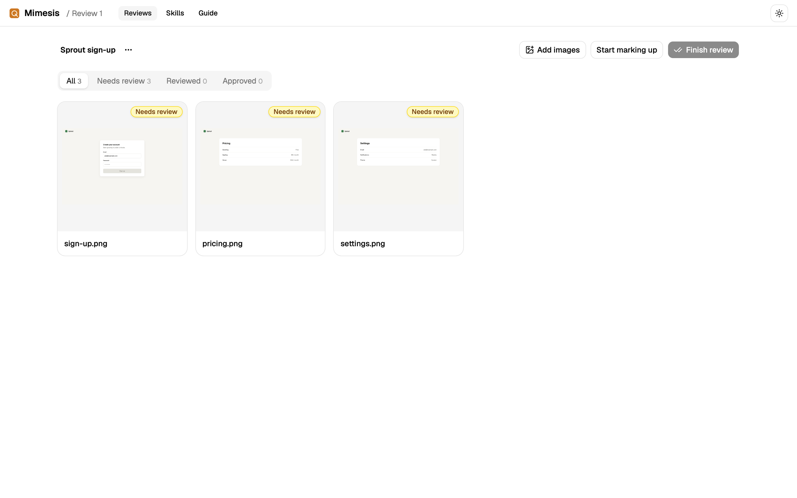
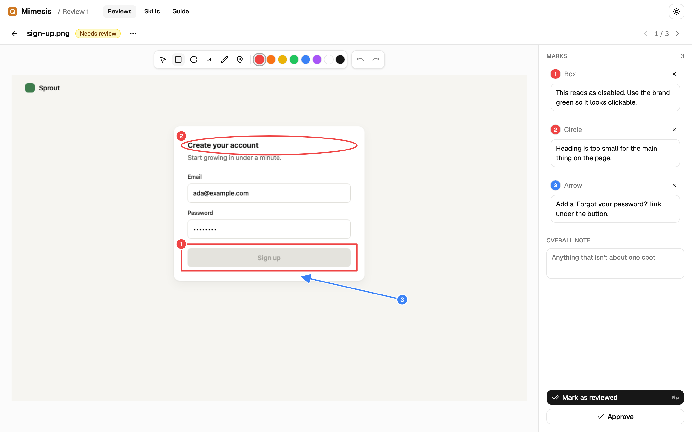
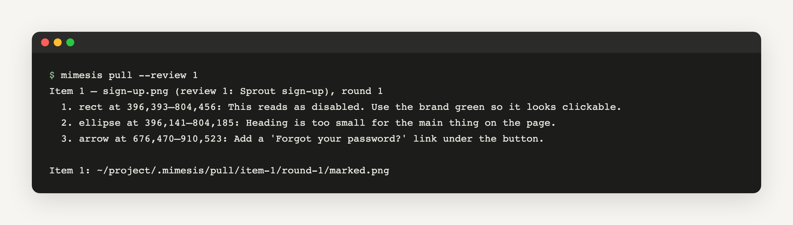
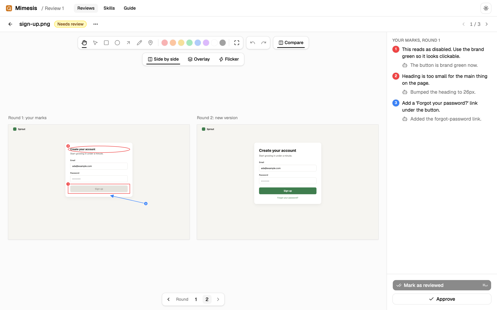
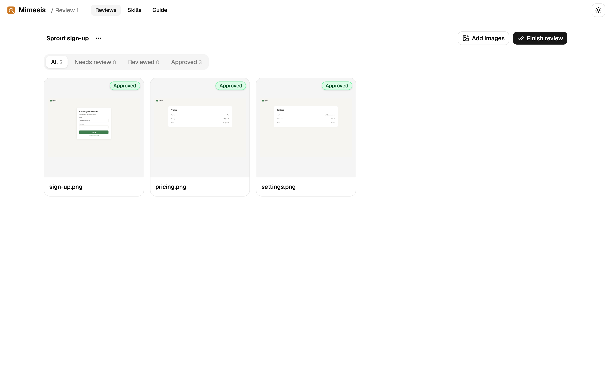

# Mimesis

Mimesis is a place for you and an AI to work on images together. You mark
up what should change, the AI sends back a new version, and you go back and
forth until you approve every image.

It works with any image: app screenshots, diagrams, generated art.

## How it works

**1. Start a review.** Drop images on the page, or have your AI add them.



**2. Mark what should change.** Draw boxes, circles, arrows, lines or pins.
Each mark gets a number and a note. Scroll to zoom in, and right-click and
drag to move around.



**3. Your AI picks it up.** It gets each image with your marks drawn on it
and your notes listed by number, and answers each mark when it sends the
new version. Mimesis lets you know when it's ready.



**4. Compare the new version.** Turn on **Compare** to see your marks next
to the new version, with the AI's answer under each one. Switch to
**Overlay** to fade between the two, or **Flicker** to swap them back and
forth so small changes jump out. Approve it, or mark it up again.



**5. Finish.** Once every image is approved, finish the review.



The same steps are on the **Guide** tab in Mimesis.

## Install

**With Docker** (nothing else to install):

```sh
git clone https://github.com/joeboylson/mimesis.git
cd mimesis
docker compose up -d
```

Then open <http://localhost:4620>. See [Running Mimesis in Docker](docs/docker.md)
for running commands and updating.

**On your computer** (needs [Rust](https://rustup.rs) and Node 18 or newer,
and includes the desktop app):

```sh
git clone https://github.com/joeboylson/mimesis.git
cd mimesis
./install.sh
mimesis open
```

This puts the `mimesis` command in `~/.local/bin` and opens Mimesis in your
browser. To get the latest version later, run `mimesis update`.

## More

- [Running Mimesis in Docker](docs/docker.md)
- [Using Mimesis](docs/using-mimesis.md): marking up, statuses, shortcuts
- [For your AI](docs/for-your-ai.md): the commands your AI runs
- [Skills](skills/README.md): ready-made instructions that teach an AI how to work with Mimesis
- [Working on Mimesis](docs/working-on-mimesis.md): how the code is laid out, settings, and how to update the screenshots above
